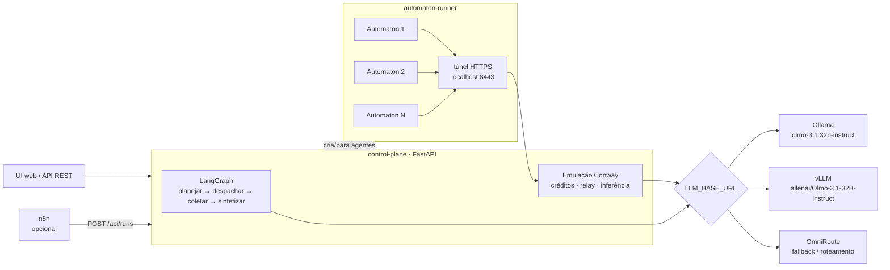

## Visão geral



O código completo está em [`/plataforma-multiagente`](https://github.com/binaryxz/docs/tree/main/plataforma-multiagente).

| Camada | Escolha | Papel na plataforma |
|---|---|---|
| LLM | **OLMo 3 / 3.1 32B Instruct** (AI2, pesos abertos) | Cérebro de todos os agentes e do orquestrador |
| Agente | **[Conway Automaton](https://github.com/Conway-Research/automaton)** | Runtime autônomo de cada agente: loop ReAct, shell, arquivos, memória, heartbeat, SOUL.md |
| Orquestração | **LangGraph** (nativo) + **n8n** (opcional) | LangGraph divide a tarefa e coordena o time; n8n dispara runs a partir de fluxos visuais |
| Gateway de LLM | Direto, ou **[OmniRoute](https://github.com/diegosouzapw/OmniRoute)** | Um endpoint OpenAI-compatível com fallback entre Ollama, vLLM e provedores |
| Hosting | Docker local, ou **[Flux](https://runonflux.com/)** | Mesmo compose roda no notebook; spec pronta para FluxCloud |

<Note>
  **Por que LangGraph como orquestrador principal e n8n como opcional?** A coordenação do time (planejar, esperar respostas assíncronas, sintetizar) é código com estado — LangGraph modela isso diretamente. O n8n entra bem na borda: disparar um time a partir de um formulário, planilha, e-mail ou Slack, e encaminhar o resultado. Os dois convivem: o n8n chama `POST /api/runs`.
</Note>

## Como o Conway Automaton roda localmente

O Automaton foi feito para a Conway Cloud: ele compra inferência com créditos, registra a identidade on-chain e conversa com outros agentes pelo relay `social.conway.tech`. Para rodar 100% local com o OLMo, a plataforma **emula essas APIs**:

| O Automaton chama | A plataforma responde |
|---|---|
| `GET /v1/credits/balance` | Saldo fixo alto → agente fica sempre no tier `high` (não há custo: o LLM é seu) |
| `POST /v1/automatons/register` | Registra o endereço da carteira do agente no banco da plataforma |
| `GET /api/tags` (descoberta Ollama) | Anuncia o modelo configurado em `LLM_MODEL` |
| `POST /v1/chat/completions` | Repassa para `LLM_BASE_URL`, reescrevendo qualquer nome de modelo para o OLMo e contabilizando tokens por agente |
| `POST /v1/messages`, `/v1/messages/poll` | Relay social local: plataforma ↔ agente e agente ↔ agente |
| Sandboxes, domínios, x402 | `501` — não suportado no modo local |

Detalhes que fazem isso funcionar:

- **HTTPS obrigatório.** O Automaton recusa HTTP fora de `localhost` para essas APIs. O runner sobe um túnel em `https://localhost:8443` com certificado autoassinado (confiado via `NODE_EXTRA_CA_CERTS`) que repassa para o control plane. Isso dispensa volume compartilhado e funciona igual na Flux.
- **Identificação por caminho.** Cada agente aponta para `https://localhost:8443/a/<id-do-agente>`, então a plataforma sabe quem chamou sem precisar verificar assinaturas.
- **Um container, N agentes.** Cada agente é um processo `automaton --run` com seu próprio `HOME` (`/data/agents/<id>/.automaton`: carteira, SQLite, SOUL.md, skills, heartbeat). O runner reinicia processos que caem e retoma os agentes após restart do container.
- **Patch de inbox** ([`patches/0001-inbox-no-wakeup.patch`](https://github.com/binaryxz/docs/tree/main/plataforma-multiagente/automaton-runner/patches)). No upstream, as mensagens que acordam o agente só aparecem no turno *seguinte* ao despertar; se o modelo decide dormir no primeiro turno, a tarefa fica parada. O patch entrega as mensagens já no turno de despertar.
- **Heartbeat ajustado**: caixa de entrada verificada a cada minuto; checagem de USDC on-chain e de atualizações do repositório desligadas.

<Warning>
  O que **não** funciona no modo local: replicação (agentes filhos dependem de sandboxes da Conway Cloud, por isso `maxChildren = 0`), compra de domínios e pagamentos x402/USDC. Se você quiser essas funções, use a Conway Cloud de verdade (`automaton --setup` com chave provisionada) em vez da emulação.
</Warning>

## Pré-requisitos

- Docker com Docker Compose v2.
- Hardware para o OLMo 3 32B:

| Opção | Memória | Observação |
|---|---|---|
| Ollama, quantizado (`olmo-3.1:32b-instruct`, ≈19 GB) | GPU de 24 GB (RTX 3090/4090) ou Mac Apple Silicon com 32 GB+ | Recomendado para uso local |
| Ollama só CPU | 32 GB+ de RAM | Funciona, mas lento (poucos tokens/s) — os agentes ficam lentos junto |
| vLLM, BF16 (`allenai/Olmo-3.1-32B-Instruct`) | ≈64 GB de VRAM para os pesos + KV cache: 1× H100/A100 80 GB ou 2× 48 GB com `VLLM_TP=2` | Melhor para vários agentes em paralelo |

<Tip>
  Use a variante **Instruct**: é a que suporta chamada de ferramentas, que é como o Automaton age (shell, arquivos, `send_message`). A variante *Think* raciocina mais, mas é mais lenta e menos confiável com tools. Para testar em máquina modesta, `LLM_MODEL=olmo-3:7b-instruct` e `OLLAMA_MODEL=olmo-3:7b-instruct` funcionam com a mesma plataforma.
</Tip>

## Rodando localmente

```bash
cd plataforma-multiagente
cp .env.example .env
# edite RUNNER_TOKEN (openssl rand -hex 24)

docker compose up -d --build                      # CPU
# ou, com GPU NVIDIA:
docker compose -f docker-compose.yml -f docker-compose.gpu.yml up -d --build

docker compose logs -f ollama-pull                # acompanha o download do modelo (~19 GB)
```

Abra **http://localhost:8080**. A barra superior mostra se o LLM e o runner do Automaton estão online.

### Criar agentes

Na aba **Agentes**, escolha um modelo (Pesquisador, Redator, Engenheiro, Analista) ou preencha:

- **Nome** e **papel** — o papel é usado pelo orquestrador para decidir quem faz o quê;
- **Prompt de gênese** — o propósito do agente (vira o `genesisPrompt` e o `SOUL.md` do Automaton).

Ao criar, o runner gera uma carteira EVM para o agente, grava a configuração e inicia o processo. Em **Abrir** você vê a conversa com o agente e os logs do loop (`[THINK]`, `[TOOL]`, `[SLEEP]`…).

<Note>
  As mensagens chegam ao agente pelo heartbeat (a cada ~1 minuto) — não é um chat síncrono. O agente responde chamando a ferramenta `send_message` para o endereço da plataforma.
</Note>

### Executar um time

Na aba **Times**, descreva a tarefa, marque os agentes e escolha o executor:

| Executor | O que acontece | Quando usar |
|---|---|---|
| **Conway Automaton** | Cada subtarefa vai para a caixa de entrada do agente; ele trabalha de forma autônoma (pode usar shell, arquivos, internet) e devolve o resultado via relay | Tarefas que exigem ação, não só texto |
| **LLM direto** | O OLMo responde cada subtarefa com o papel do agente como *system prompt* | Testar rápido, tarefas só de texto, ou sem o runner |

O grafo LangGraph registra cada passo em **Eventos** e mostra a **Entrega final** sintetizada.

Cada subtarefa leva uma etiqueta (`#1a2b3c4d`) que o agente repete no início da resposta; é assim que a plataforma sabe a que run pertence cada resposta quando um agente tem várias tarefas abertas. Se o agente omitir a etiqueta, vale o `reply_to` da mensagem e, por fim, a tarefa aberta mais antiga daquele agente. Runs que esperam mais que `RUN_TIMEOUT_S` (padrão 30 min) são sintetizados com o que chegou.

### API

Tudo que a UI faz está na API (documentação interativa em `http://localhost:8080/docs`):

```bash
# criar agente
curl -X POST localhost:8080/api/agents -H 'Content-Type: application/json' \
  -d '{"name":"Pesquisador","role":"pesquisa de mercado","genesis_prompt":"Você levanta informações e cita fontes."}'

# executar um time e esperar o resultado
curl -X POST localhost:8080/api/runs -H 'Content-Type: application/json' \
  -d '{"task":"Mapeie 5 concorrentes e resuma os diferenciais","agent_ids":["pesquisador-1a2b3c","redator-4d5e6f"],"executor":"automaton","wait":true}'
```

Com `ADMIN_TOKEN` definido, envie `-H "Authorization: Bearer $ADMIN_TOKEN"`.

## n8n (opcional)

```bash
# .env
COMPOSE_PROFILES=ollama,n8n
docker compose up -d
```

1. Abra **http://localhost:5678** e importe [`n8n/executar-time.json`](https://github.com/binaryxz/docs/tree/main/plataforma-multiagente/n8n/executar-time.json).
2. Ative o workflow. Ele expõe `POST /webhook/multiagente`, chama `POST /api/runs` com `wait: true` e devolve a entrega final:

```bash
curl -X POST localhost:5678/webhook/multiagente -H 'Content-Type: application/json' \
  -d '{"task":"Escreva um post sobre OLMo 3","agent_ids":["redator-4d5e6f"],"executor":"llm"}'
```

Para o caminho inverso (a plataforma avisa o n8n quando um run termina), defina `RUN_WEBHOOK_URL=http://n8n:5678/webhook/run-finalizado` e crie um workflow com esse webhook (ex.: enviar o resultado para Slack ou planilha).

## OmniRoute como gateway (opcional)

O [OmniRoute](https://github.com/diegosouzapw/OmniRoute) é um gateway de IA open source (MIT) que expõe **um** endpoint OpenAI-compatível e roteia para vários provedores, com fallback e balanceamento. Útil para: cair para um provedor externo quando o OLMo local estiver saturado, distribuir carga entre várias GPUs, ou centralizar chaves e logs.

```bash
# .env
COMPOSE_PROFILES=ollama,omniroute
OMNIROUTE_PASSWORD=uma-senha-forte
```

1. `docker compose up -d` e abra **http://localhost:20128**.
2. Cadastre o Ollama como provedor OpenAI-compatível com base URL `http://ollama:11434/v1` (ou o vLLM em `http://vllm:8000/v1`).
3. Copie a API key em **Dashboard → Endpoints** e ajuste o `.env`:

```bash
LLM_BASE_URL=http://omniroute:20128/v1
LLM_MODEL=ollama/olmo-3.1:32b-instruct   # nome do modelo como aparece no OmniRoute
LLM_API_KEY=sk-...
```

4. `docker compose up -d control-plane` para aplicar.

<Warning>
  O gateway enxerga todos os prompts e respostas e guarda as chaves dos provedores. Mantenha `REQUIRE_API_KEY=true` (já configurado no compose) e a porta 20128 restrita a `127.0.0.1`.
</Warning>

## Deploy na Flux

A Flux roda containers Docker em nós descentralizados. A spec em [`flux/app-spec.json`](https://github.com/binaryxz/docs/tree/main/plataforma-multiagente/flux/app-spec.json) tem dois componentes: `controlplane` (UI/API, porta pública 38080) e `runner` (agentes, sem porta pública).

### Onde roda o OLMo 32B

Os nós comuns da FluxCloud não têm GPU, e o 32B em CPU fica lento demais para agentes. Duas opções:

1. **Recomendado:** alugar uma GPU na **[FluxEdge](https://docs.runonflux.com/fluxedge/overview/)** (marketplace de GPUs da Flux — RTX 4090, A6000, A100, H100) e subir o vLLM ou o Ollama lá, com o mesmo comando do perfil `vllm` deste compose. Use o endpoint resultante em `LLM_BASE_URL`, de preferência atrás de HTTPS com uma API key (por exemplo, colocando o OmniRoute na frente).
2. **Só para testes:** um terceiro componente com Ollama em CPU e `olmo-3:7b-instruct`.

### OLMo na FluxEdge com a plataforma no seu computador

Se o seu computador não tem GPU nem espaço para o modelo (~20 GB), separe as partes: o OLMo roda na FluxEdge com [`flux/olmo-gpu`](https://github.com/binaryxz/docs/tree/main/plataforma-multiagente/flux/olmo-gpu) (Ollama + gateway com chave) e a plataforma roda local sem o perfil `ollama`, ocupando ~1 GB:

```bash
# .env da plataforma
COMPOSE_PROFILES=
LLM_BASE_URL=http://IP-DA-GPU:8080/v1
LLM_API_KEY=<OLMO_API_KEY definido na GPU>
LLM_MODEL=olmo-3.1:32b-instruct
```

### Passo a passo

```bash
# 1. publique as imagens (a Flux exige amd64)
./flux/publicar-imagens.sh seu_usuario_dockerhub 0.1.0
```

2. Em `flux/app-spec.json`, troque `SEU_ZELID`, `SEU_USUARIO`, `LLM_BASE_URL`, `LLM_MODEL`, `LLM_API_KEY` e os três `TROQUE` (o mesmo `RUNNER_TOKEN` nos dois componentes; um `ADMIN_TOKEN` forte — a UI fica pública).
3. Registre o app em [cloud.runonflux.com](https://cloud.runonflux.com) (Register New App → modo avançado/JSON) e pague a assinatura.
4. Acesse `https://multiagente.app.runonflux.io` (ou o domínio que você configurar).

Notas da spec:

- Os componentes se enxergam pelo hostname `flux<componente>_<app>` (`fluxcontrolplane_multiagente`, `fluxrunner_multiagente`). Se renomear o app ou os componentes, ajuste `RUNNER_URL` e `CONTROL_PLANE_URL`.
- `containerData: "g:/data"` usa o modo de dados sincronizados da Flux: uma instância ativa e as demais em espera com o volume replicado. Isso é necessário porque o estado (SQLite da plataforma, carteiras e memória dos agentes) não pode divergir entre instâncias.

<Note>
  Confira a [documentação de specs da Flux](https://docs.runonflux.com/fluxcloud/cloud/register-new-app/components) antes de registrar: o formato da spec e a sintaxe de volumes sincronizados evoluem entre versões do FluxOS.
</Note>

## Segurança

- **Os agentes executam comandos de verdade.** Sem sandbox Conway, o `exec` do Automaton roda dentro do container do runner (usuário `node`, sem acesso ao Docker do host, sem portas publicadas). Todos os agentes compartilham esse container, então um agente consegue ler os arquivos de outro. Para isolar times diferentes, suba um runner por time.
- **O runtime do Automaton fica somente-leitura** (`/opt/automaton` pertence ao root), então a automodificação de um agente não afeta os outros.
- **As carteiras são reais** (chaves EVM em `/data/agents/<id>/.automaton/wallet.json`). Não deposite fundos nelas no modo local.
- **Exposição:** por padrão a UI escuta só em `127.0.0.1`. Ao expor (`UI_BIND=0.0.0.0` ou Flux), defina `ADMIN_TOKEN`.

## Estrutura

```
plataforma-multiagente/
├── docker-compose.yml          # ollama | vllm | omniroute | n8n + plataforma
├── docker-compose.gpu.yml      # GPU NVIDIA para o Ollama
├── .env.example
├── control-plane/              # FastAPI + LangGraph + UI
│   └── app/
│       ├── main.py             # API REST e UI
│       ├── teams.py            # grafo LangGraph (planejar → despachar → coletar → sintetizar)
│       ├── conway.py           # emulação da Conway Cloud (créditos, relay, inferência)
│       ├── llm.py              # cliente OpenAI-compatível (OLMo)
│       ├── runner.py, db.py, config.py
│       └── static/             # UI (HTML/CSS/JS, sem build)
├── automaton-runner/           # Conway Automaton (commit fixo) + supervisor multi-agente
│   ├── Dockerfile
│   ├── server.mjs              # API do runner + túnel HTTPS
│   └── patches/
├── n8n/executar-time.json
└── flux/                       # spec da Flux + script de publicação de imagens
```

## Como foi validado

O fluxo completo foi exercitado com o Automaton compilado do commit fixado no `Dockerfile` e um LLM OpenAI-compatível simulado: criação de agentes pela API, registro, descoberta do modelo, turnos de inferência com tools, `send_message` pelo relay local, execução de time com os dois executores (incluindo `wait=true`, usado pelo n8n) e retomada dos agentes após restart do runner. A qualidade das respostas com o OLMo 3 real depende do hardware e não foi medida aqui.
