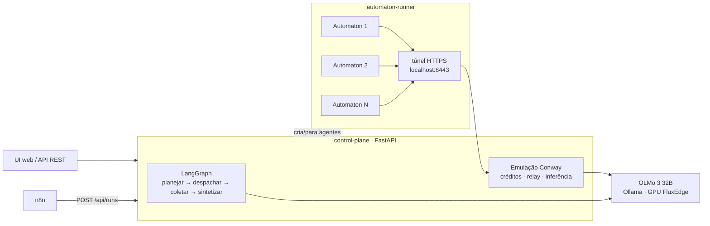

## Visão geral



O código completo está em [`/plataforma-multiagente`](https://github.com/binaryxz/docs/tree/main/plataforma-multiagente).

| Camada | Escolha | Papel na plataforma |
|---|---|---|
| LLM | **OLMo 3 32B** (`olmo-3.1:32b-instruct`, AI2, pesos abertos) | Cérebro de todos os agentes e do orquestrador |
| Agente | **[Conway Automaton](https://github.com/Conway-Research/automaton)** | Runtime autônomo de cada agente: loop ReAct, shell, arquivos, memória, heartbeat, SOUL.md |
| Orquestração | **LangGraph** + **n8n** | LangGraph divide a tarefa e coordena o time; n8n dispara runs a partir de fluxos visuais |
| Hosting | **[Flux](https://runonflux.com/)** | OLMo numa GPU da FluxEdge; plataforma na FluxCloud (ou no seu computador para desenvolvimento) |

<Note>
  **Por que LangGraph e n8n juntos?** A coordenação do time (planejar, esperar respostas assíncronas, sintetizar) é código com estado — LangGraph modela isso diretamente. O n8n entra bem na borda: disparar um time a partir de um formulário, planilha, e-mail ou Slack, e encaminhar o resultado. Os dois convivem: o n8n chama `POST /api/runs`.
</Note>

## Como o Conway Automaton roda localmente

O Automaton foi feito para a Conway Cloud: ele compra inferência com créditos, registra a identidade on-chain e conversa com outros agentes pelo relay `social.conway.tech`. Para rodar 100% local com o OLMo, a plataforma **emula essas APIs**:

| O Automaton chama | A plataforma responde |
|---|---|
| `GET /v1/credits/balance` | Saldo fixo alto → agente fica sempre no tier `high` (não há custo: o LLM é seu) |
| `POST /v1/automatons/register` | Registra o endereço da carteira do agente no banco da plataforma |
| `GET /api/tags` (descoberta Ollama) | Anuncia o modelo configurado em `LLM_MODEL` |
| `POST /v1/chat/completions` | Repassa para `LLM_BASE_URL`, reescrevendo qualquer nome de modelo para o OLMo e contabilizando tokens por agente |
| `POST /v1/messages`, `/v1/messages/poll` | Relay social local: plataforma ↔ agente e agente ↔ agente |
| Sandboxes, domínios, x402 | `501` — não suportado no modo local |

Detalhes que fazem isso funcionar:

- **HTTPS obrigatório.** O Automaton recusa HTTP fora de `localhost` para essas APIs. O runner sobe um túnel em `https://localhost:8443` com certificado autoassinado (confiado via `NODE_EXTRA_CA_CERTS`) que repassa para o control plane. Isso dispensa volume compartilhado e funciona igual na Flux.
- **Identificação por caminho.** Cada agente aponta para `https://localhost:8443/a/<id-do-agente>`, então a plataforma sabe quem chamou sem precisar verificar assinaturas.
- **Um container, N agentes.** Cada agente é um processo `automaton --run` com seu próprio `HOME` (`/data/agents/<id>/.automaton`: carteira, SQLite, SOUL.md, skills, heartbeat). O runner reinicia processos que caem e retoma os agentes após restart do container.
- **Patch de inbox** ([`patches/0001-inbox-no-wakeup.patch`](https://github.com/binaryxz/docs/tree/main/plataforma-multiagente/automaton-runner/patches)). No upstream, as mensagens que acordam o agente só aparecem no turno *seguinte* ao despertar; se o modelo decide dormir no primeiro turno, a tarefa fica parada. O patch entrega as mensagens já no turno de despertar.
- **Heartbeat ajustado**: caixa de entrada verificada a cada minuto; checagem de USDC on-chain e de atualizações do repositório desligadas.

<Warning>
  O que **não** funciona no modo local: replicação (agentes filhos dependem de sandboxes da Conway Cloud, por isso `maxChildren = 0`), compra de domínios e pagamentos x402/USDC. Se você quiser essas funções, use a Conway Cloud de verdade (`automaton --setup` com chave provisionada) em vez da emulação.
</Warning>

## Pré-requisitos

- Docker com Docker Compose v2.
- Hardware para o OLMo 3 32B:

| Opção | Memória | Observação |
|---|---|---|
| GPU da FluxEdge com o OLMo ([`flux/olmo-gpu`](https://github.com/binaryxz/docs/tree/main/plataforma-multiagente/flux/olmo-gpu)) | 24 GB+ de VRAM (RTX 4090, A6000, A100, H100) | Recomendado: a plataforma ocupa ~1 GB onde rodar |
| OLMo na mesma máquina da plataforma (perfil `olmo`) | GPU de 24 GB e ~20 GB de disco | Tudo num lugar só |

<Tip>
  Use a variante **Instruct**: é a que suporta chamada de ferramentas, que é como o Automaton age (shell, arquivos, `send_message`). A variante *Think* raciocina mais, mas é mais lenta e menos confiável com tools.
</Tip>

## Rodando localmente

```bash
cd plataforma-multiagente
cp .env.example .env
# edite RUNNER_TOKEN e ADMIN_PASSWORD (openssl rand -hex 24)

# OLMo na mesma máquina (GPU NVIDIA):
docker compose -f docker-compose.yml -f docker-compose.gpu.yml up -d --build
docker compose logs -f ollama-pull                # download do OLMo (~19 GB)

# ou OLMo na FluxEdge: tire "olmo" de COMPOSE_PROFILES, ajuste LLM_BASE_URL/LLM_API_KEY e
docker compose up -d --build
```

Abra **http://localhost:8080** e entre com `ADMIN_USER`/`ADMIN_PASSWORD`. A barra superior mostra se o LLM e o runner do Automaton estão online.

### Criar agentes

Na aba **Agentes**, escolha um modelo (Pesquisador, Redator, Engenheiro, Analista) ou preencha:

- **Nome** e **papel** — o papel é usado pelo orquestrador para decidir quem faz o quê;
- **Prompt de gênese** — o propósito do agente (vira o `genesisPrompt` e o `SOUL.md` do Automaton).

Ao criar, o runner gera uma carteira EVM para o agente, grava a configuração e inicia o processo. Em **Abrir** você vê a conversa com o agente e os logs do loop (`[THINK]`, `[TOOL]`, `[SLEEP]`…).

<Note>
  As mensagens chegam ao agente pelo heartbeat (a cada ~1 minuto) — não é um chat síncrono. O agente responde chamando a ferramenta `send_message` para o endereço da plataforma.
</Note>

### Executar um time

Na aba **Times**, descreva a tarefa, marque os agentes e escolha o executor:

| Executor | O que acontece | Quando usar |
|---|---|---|
| **Conway Automaton** | Cada subtarefa vai para a caixa de entrada do agente; ele trabalha de forma autônoma (pode usar shell, arquivos, internet) e devolve o resultado via relay | Tarefas que exigem ação, não só texto |
| **LLM direto** | O OLMo responde cada subtarefa com o papel do agente como *system prompt* | Testar rápido, tarefas só de texto, ou sem o runner |

O grafo LangGraph registra cada passo em **Eventos** e mostra a **Entrega final** sintetizada.

Cada subtarefa leva uma etiqueta (`#1a2b3c4d`) que o agente repete no início da resposta; é assim que a plataforma sabe a que run pertence cada resposta quando um agente tem várias tarefas abertas. Se o agente omitir a etiqueta, vale o `reply_to` da mensagem e, por fim, a tarefa aberta mais antiga daquele agente. Runs que esperam mais que `RUN_TIMEOUT_S` (padrão 30 min) são sintetizados com o que chegou.

### API

Tudo que a UI faz está na API (documentação interativa em `http://localhost:8080/docs`):

```bash
# criar agente
curl -X POST localhost:8080/api/agents -H 'Content-Type: application/json' \
  -d '{"name":"Pesquisador","role":"pesquisa de mercado","genesis_prompt":"Você levanta informações e cita fontes."}'

# executar um time e esperar o resultado
curl -X POST localhost:8080/api/runs -H 'Content-Type: application/json' \
  -d '{"task":"Mapeie 5 concorrentes e resuma os diferenciais","agent_ids":["pesquisador-1a2b3c","redator-4d5e6f"],"executor":"automaton","wait":true}'
```

Com `ADMIN_TOKEN` definido, envie `-H "Authorization: Bearer $ADMIN_TOKEN"`.

## n8n

O perfil `n8n` já vem ligado no `.env.example` (`COMPOSE_PROFILES=olmo,n8n`).

1. Abra **http://localhost:5678** e importe [`n8n/executar-time.json`](https://github.com/binaryxz/docs/tree/main/plataforma-multiagente/n8n/executar-time.json).
2. Ative o workflow. Ele expõe `POST /webhook/multiagente`, chama `POST /api/runs` com `wait: true` e devolve a entrega final:

```bash
curl -X POST localhost:5678/webhook/multiagente -H 'Content-Type: application/json' \
  -d '{"task":"Escreva um post sobre OLMo 3","agent_ids":["redator-4d5e6f"],"executor":"llm"}'
```

Para o caminho inverso (a plataforma avisa o n8n quando um run termina), defina `RUN_WEBHOOK_URL=http://n8n:5678/webhook/run-finalizado` e crie um workflow com esse webhook (ex.: enviar o resultado para Slack ou planilha).

## Deploy na Flux

A Flux roda containers Docker em nós descentralizados. A spec em [`flux/app-spec.json`](https://github.com/binaryxz/docs/tree/main/plataforma-multiagente/flux/app-spec.json) tem dois componentes: `controlplane` (UI/API, porta pública 38080) e `runner` (agentes, sem porta pública).

### Onde roda o OLMo 32B

Os nós comuns da FluxCloud não têm GPU, então o OLMo 3 32B roda numa GPU alugada na **[FluxEdge](https://docs.runonflux.com/fluxedge/overview/)** (marketplace de GPUs da Flux — RTX 4090, A6000, A100, H100) com [`flux/olmo-gpu`](https://github.com/binaryxz/docs/tree/main/plataforma-multiagente/flux/olmo-gpu): Ollama servindo o OLMo atrás de um gateway que só aceita requisições com a sua chave. Use o endereço dele em `LLM_BASE_URL`.

## LLM sem GPU própria (NVIDIA / OmniRoute)

A plataforma fala com qualquer API compatível com OpenAI, então dá para usar o LLM de um provedor em vez de uma GPU sua. Tire `olmo` do `COMPOSE_PROFILES` e configure o `.env`:

- **NVIDIA** ([build.nvidia.com](https://build.nvidia.com)) — grátis dentro dos limites deles, dezenas de modelos abertos:
  ```
  LLM_BASE_URL=https://integrate.api.nvidia.com/v1
  LLM_API_KEY=nvapi-...
  LLM_MODEL=meta/llama-3.1-70b-instruct
  ```
- **OmniRoute** — gateway que agrega vários provedores (muitos com nível grátis) num só endpoint; cadastre os provedores no painel dele e use `LLM_MODEL=auto`.

Sobre "tokens infinitos": não há cobrança por token nesses caminhos, mas cada provedor tem limites de uso (rate limit). "Ilimitado" de verdade, sem depender de terceiros, só com o OLMo auto-hospedado na sua GPU/FluxEdge.

### OLMo na FluxEdge com a plataforma no seu computador

Se o seu computador não tem GPU nem espaço para o modelo (~20 GB), separe as partes: o OLMo roda na FluxEdge com [`flux/olmo-gpu`](https://github.com/binaryxz/docs/tree/main/plataforma-multiagente/flux/olmo-gpu) (Ollama + gateway com chave) e a plataforma roda local sem o perfil `olmo`, ocupando ~1 GB:

```bash
# .env da plataforma
COMPOSE_PROFILES=n8n
LLM_BASE_URL=http://IP-DA-GPU:8080/v1
LLM_API_KEY=<OLMO_API_KEY definido na GPU>
LLM_MODEL=olmo-3.1:32b-instruct
```

### Passo a passo

```bash
# 1. publique as imagens (a Flux exige amd64)
./flux/publicar-imagens.sh seu_usuario_dockerhub 0.1.0
```

2. Em `flux/app-spec.json`, troque `SEU_ZELID`, `SEU_USUARIO`, `LLM_BASE_URL`, `LLM_MODEL`, `LLM_API_KEY` e os `TROQUE` (o mesmo `RUNNER_TOKEN` nos dois componentes; uma `ADMIN_PASSWORD` forte, porque o painel fica público).
3. Registre o app em [cloud.runonflux.com](https://cloud.runonflux.com) (Register New App → modo avançado/JSON) e pague a assinatura.
4. Acesse `https://multiagente.app.runonflux.io` (ou o domínio que você configurar).

Notas da spec:

- Os componentes se enxergam pelo hostname `flux<componente>_<app>` (`fluxcontrolplane_multiagente`, `fluxrunner_multiagente`). Se renomear o app ou os componentes, ajuste `RUNNER_URL` e `CONTROL_PLANE_URL`.
- `containerData: "g:/data"` usa o modo de dados sincronizados da Flux: uma instância ativa e as demais em espera com o volume replicado. Isso é necessário porque o estado (SQLite da plataforma, carteiras e memória dos agentes) não pode divergir entre instâncias.

<Note>
  Confira a [documentação de specs da Flux](https://docs.runonflux.com/fluxcloud/cloud/register-new-app/components) antes de registrar: o formato da spec e a sintaxe de volumes sincronizados evoluem entre versões do FluxOS.
</Note>

## Segurança

- **Os agentes executam comandos de verdade.** Sem sandbox Conway, o `exec` do Automaton roda dentro do container do runner (usuário `node`, sem acesso ao Docker do host, sem portas publicadas). Todos os agentes compartilham esse container, então um agente consegue ler os arquivos de outro. Para isolar times diferentes, suba um runner por time.
- **O runtime do Automaton fica somente-leitura** (`/opt/automaton` pertence ao root), então a automodificação de um agente não afeta os outros.
- **As carteiras são reais** (chaves EVM em `/data/agents/<id>/.automaton/wallet.json` e `/data/wallets/`). Transferências de USDT/ETH pedem a senha do painel e respeitam `MAX_USDT_PER_TX`/`MAX_ETH_PER_TX`. Teste antes com `ETH_NETWORK=sepolia`.
- **Exposição:** por padrão o painel escuta só em `127.0.0.1`. Ao expor (`UI_BIND=0.0.0.0` ou Flux), defina `ADMIN_PASSWORD` e use HTTPS (`COOKIE_SECURE=true`).

## Estrutura

```
plataforma-multiagente/
├── docker-compose.yml          # OLMo (perfil olmo) + n8n + plataforma
├── docker-compose.gpu.yml      # GPU NVIDIA para o Ollama
├── .env.example
├── control-plane/              # FastAPI + LangGraph + UI
│   └── app/
│       ├── main.py             # API REST e UI
│       ├── teams.py            # grafo LangGraph (planejar → despachar → coletar → sintetizar)
│       ├── conway.py           # emulação da Conway Cloud (créditos, relay, inferência)
│       ├── llm.py              # cliente OpenAI-compatível (OLMo)
│       ├── runner.py, db.py, config.py
│       └── static/             # UI (HTML/CSS/JS, sem build)
├── automaton-runner/           # Conway Automaton (commit fixo) + supervisor multi-agente
│   ├── Dockerfile
│   ├── server.mjs              # API do runner + túnel HTTPS
│   ├── wallets.mjs             # carteiras EVM e USDT/ETH na Ethereum
│   └── patches/
├── n8n/executar-time.json
└── flux/                       # spec da FluxCloud, OLMo na FluxEdge (olmo-gpu/) e publicação de imagens
```

## Como foi validado

O fluxo completo foi exercitado com o Automaton compilado do commit fixado no `Dockerfile` e um LLM OpenAI-compatível simulado: criação de agentes pela API, registro, descoberta do modelo, turnos de inferência com tools, `send_message` pelo relay local, execução de time com os dois executores (incluindo `wait=true`, usado pelo n8n) e retomada dos agentes após restart do runner. A qualidade das respostas com o OLMo 3 real depende do hardware e não foi medida aqui.
