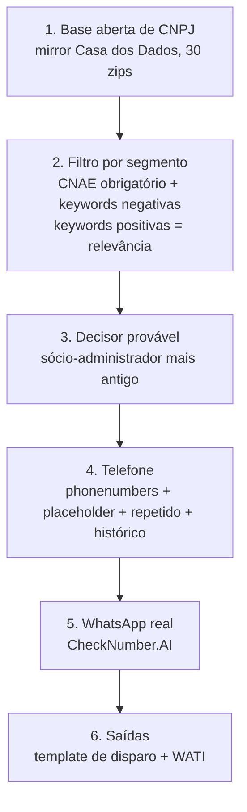

## Visão geral

É a mesma arquitetura da [prospecção fintech](/prospeccao-fintech/guia). A única etapa que muda de verdade é o **filtro** (etapa 2). Baixar a base, achar o decisor, validar o telefone, checar o WhatsApp e gerar o formato de saída funcionam do mesmo jeito.



Scripts em [`/prospeccao-advocacia-contabilidade/scripts`](https://github.com/binaryxz/docs/tree/main/prospeccao-advocacia-contabilidade/scripts):

| Etapa | Script |
|---|---|
| 1. Baixar a base | `baixar_base_receita.sh` |
| 2 e 3. Filtro + decisor | `filtrar_cnpjs_segmento.py --segmento advocacia\|contabil` |
| 4. Telefone | `preparar_telefones.py` (reaproveita o `validar_telefone.py` da fintech sem mudança) |
| 5. WhatsApp | `checar_whatsapp_checknumber.py` |
| 6. Saídas | `gerar_saidas.py` |

Dependências: Python 3.10+ e `prospeccao-fintech/scripts/requirements.txt` (`pandas`, `phonenumbers`, `requests`).

<Warning>
  Se aparecer `ModuleNotFoundError` logo depois de um `pip install`, provavelmente o ambiente tem dois Pythons (ex.: `pip` instalou no 3.13 e `python3` aponta pro 3.11). Use `python3 -m pip install -r prospeccao-fintech/scripts/requirements.txt` para instalar no mesmo interpretador que vai rodar os scripts.
</Warning>

<Note>
  Nome, CPF mascarado e cargo dos sócios são dados pessoais. Trate as listas como informação sensível, com acesso restrito ao time comercial, e descarte o que não avançar, conforme a LGPD.
</Note>

## Etapa 1 — Baixar a base da Receita

```bash
prospeccao-advocacia-contabilidade/scripts/baixar_base_receita.sh ./dados_rf
# ou fixando o snapshot: ... ./dados_rf 2026-09-14
```

O script lista `https://dados-abertos-rf-cnpj.casadosdados.com.br/arquivos/` para achar o snapshot mais recente (atualização mensal) e baixa `Estabelecimentos{0-9}.zip`, `Empresas{0-9}.zip`, `Socios{0-9}.zip` e `Municipios.zip`, que traduz o código do município para o nome. São cerca de 7 GB. Os downloads rodam em paralelo (`PARALELO=4` por padrão) e o script testa a integridade de cada zip. Se ele for interrompido, é só rodar de novo: o que já está íntegro não é baixado outra vez.

<Warning>
  Ao montar `curl` em paralelo com `xargs`, **nunca coloque `--` antes da URL** junto com `-o arquivo.zip`. O `--` faz o curl tratar `-o` e o nome do arquivo como URLs extras, e o binário vaza para o stdout/log. O script usa `curl -sS --retry 3 -o {nome} {url}`, sem `--`.
</Warning>

## Etapa 2 — Filtro por segmento

Rode **uma vez por segmento**, com saídas separadas. As keywords negativas de um segmento não fazem sentido no outro, por isso as listas nunca são misturadas.

```bash
D=dados_rf/2026-09-14
for seg in advocacia contabil; do
  python prospeccao-advocacia-contabilidade/scripts/filtrar_cnpjs_segmento.py \
    --segmento $seg \
    --estabelecimentos "$D/Estabelecimentos*.zip" \
    --empresas "$D/Empresas*.zip" \
    --socios "$D/Socios*.zip" \
    --municipios $D/Municipios.zip \
    --saida leads_$seg.csv
done
```

### Segmento `advocacia`

| CNAE | Descrição | Papel |
|---|---|---|
| 6911-7/01 | Serviços advocatícios | **obrigatório** (peso 2) |
| 6911-7/02 | Atividades auxiliares da justiça | conta pro match, mas sozinho não basta (peso 1) |
| 6912-5/01 | Serviços notariais e de registro | **excluído sempre** quando é o CNAE principal (cartório) |
| 6920602, 7020400, 6201501, 6209100, 6311900 | consultoria / tech / dados | só sinalizam perfil empresarial (ordenação) |

- **Positivas:** SOCIEDADE DE ADVOGADOS, ADVOGADOS ASSOCIADOS, ADVOCACIA EMPRESARIAL, ADVOGADOS EMPRESARIAIS, ASSESSORIA JURIDICA (EMPRESARIAL), CONSULTORIA JURIDICA, JURIDICO EMPRESARIAL, BOUTIQUE JURIDICA, SOCIETARIO/A, TRIBUTARIO/A, CORPORAT\*, CONTRATOS, COMPLIANCE, EMPRESARIAL
- **Negativas:** FAMILIAR, FAMILIA, DIVORCIO, INVENTARIO, SUCESSOES, PENAL, CRIMINAL, CRIMINAIS, PREVIDENCIARIO, INSS, APOSENTADORIA, PENSAO, INDENIZACAO, ACIDENTE, CONSUMIDOR, IMOBILIARIO, DANOS MORAIS, ERRO MEDICO, BANCARIO, AUXILIO-DOENCA

### Segmento `contabil`

| CNAE | Descrição | Papel |
|---|---|---|
| 6920-6/01 | Atividades de contabilidade | **obrigatório** (um dos dois, peso 2) |
| 6920-6/02 | Consultoria e auditoria contábil e tributária | **obrigatório** (um dos dois, peso 2) |
| 7020400, 6201501, 6209100, 6311900 | consultoria / tech / dados | só sinalizam (ordenação) |

- **Positivas:** ASSESSORIA CONTABIL, CONTABILIDADE EMPRESARIAL, CONTABIL EMPRESARIAL, CONTABILIDADE E AUDITORIA, AUDITORIA, AUDITOR\*, AUDIT, BPO FINANCEIRO/FISCAL/CONTABIL, CONSULTIVA, CONSULTORIA CONTABIL/TRIBUTARIA, GESTAO TRIBUTARIA, PLANEJAMENTO TRIBUTARIO, CONTABILIDADE GERENCIAL, CONTROLADORIA, CONTROLLER
- **Negativas:** MEI, MEIS, AUTONOMOS, PARA MEDICOS, PARA DENTISTAS, PROFISSIONAIS LIBERAIS, SIMPLES, CURSOS, ESCOLA, EDUCACIONAL, FRANQUIA, PROMOCIONAL, PARA VOCE

As listas ficam editáveis em `SEGMENTOS`, no topo do script.

### Regra de entrada

1. CNPJ **ativo** (situação cadastral 02).
2. Bate o limiar ponderado de CNAEs do segmento (principal + secundários, `--limiar 0.35`). Com os pesos acima, isso equivale a ter **6911701** (advocacia) ou **6920601/6920602** (contábil).
3. CNAE principal fora de `cnaes_excluir` (cartório).
4. **Nenhuma keyword negativa** na razão social **nem** no nome fantasia. Se bater, o CNPJ sai, mesmo que tenha batido CNAE ou keyword positiva.
5. As keywords **positivas** não decidem quem entra: elas alimentam `keywords_positivas` e `relevancia`, e a saída vem ordenada por relevância.

`relevancia` = +2 se tem keyword positiva, +1 por CNAE-sinal e +1 se entrou por CNAE.

A ordenação põe **primeiro quem tem o CNAE do segmento como principal** (coluna `cnae_principal_do_segmento`) e só depois aplica a relevância. Sem isso, consultorias e empresas de TI que têm 6911701 ou 6920601 só como CNAE secundário subiam pro topo somando CNAEs-sinal. Na primeira lista de teste, isso afetou 524 dos 1.600 leads da contábil.

<Note>
  **Por que as keywords positivas não decidem a entrada por padrão?** Termos como EMPRESARIAL, CONTRATOS, AUDITORIA e CONSULTIVA aparecem em dezenas de milhares de empresas que não são escritórios ("XYZ Empresarial Ltda", consultorias de TI...). Sem o CNAE como portão, a lista vira ruído. Isso foi medido na base real: veja [Resultados da primeira rodada](#resultados-da-primeira-rodada). Duas flags mudam esse comportamento:
  - `--exigir-keyword`: mantém só quem tem CNAE **e** keyword positiva. A lista fica menor e mais "empresarial".
  - `--incluir-so-keyword`: aceita também quem bateu só a keyword positiva, sem o CNAE do segmento. É a regra literal "CNAE OU keyword", que traz muito falso positivo.
</Note>

**Como a comparação funciona:** o texto é comparado sem acento, em minúsculas e com a pontuação virando espaço. Cada termo precisa bater como **palavra inteira**. Por isso `MEI` não casa com "Meireles", `PENAL` não casa com "Penalva", e `AUXILIO-DOENCA` casa com "Auxílio Doença". Termo terminado em `*` funciona como prefixo: `CORPORAT*` pega corporativo, corporativa e corporate; `AUDITOR*` pega auditor, auditores e auditoria. O `AUDIT*` original da especificação foi trocado porque, na base real, casava "aparelhos auditivos".

### Teto de capital social

Não chute um teto. Rode **sem** `--capital-maximo` primeiro. No final, o script imprime a distribuição de `capital_social` dos leads (percentis e faixas). Decida o corte olhando esses números e rode de novo com `--capital-maximo` se fizer sentido. Em escritório de advocacia e de contabilidade, o capital social reflete mal o porte: escritório grande costuma ter capital baixo, porque não é holding de produto.

## Etapa 3 — Decisor provável

Já vem na saída da etapa 2 quando você passa `--socios`. A lógica é a mesma da fintech: prioriza a qualificação de administrador (códigos `10`, `16`, `22`, `49`, `65`) e desempata pela data de entrada na sociedade mais antiga. Colunas: `nome_decisor`, `documento_decisor`, `qualificacao_socio`, `eh_decisor`, `data_entrada_sociedade`.

## Etapa 4 — Telefone

```bash
python prospeccao-advocacia-contabilidade/scripts/preparar_telefones.py \
  leads_advocacia.csv leads_advocacia_tel.csv \
  --txt-checknumber numeros_advocacia.txt \
  --historico wati_contatos_export.csv "disparos_anteriores/*.csv"
```

A validação de formato reaproveita `valida_numero()` de `prospeccao-fintech/scripts/validar_telefone.py` **sem mudança** (`phonenumbers`, offline). O script tenta `telefone_1` e, se esse não for válido, `telefone_2`. Em cima disso, aplica as armadilhas que já conhecemos. O resultado sai em `telefone_status`:

| `telefone_status` | Significado |
|---|---|
| `ok` | vai pra checagem de WhatsApp |
| `sem_numero` / `nao` | sem telefone / formato inválido (DDD inexistente etc.) |
| `uf_ex` | UF = "EX" (ex.: fundos administrados por DTVM com `+551140090000`) |
| `suspeito_repetido` | placeholder (últimos 9 dígitos com ≤ 2 dígitos distintos, tipo `+5511999999999`) **ou** o mesmo número em mais de `--max-cnpjs-por-telefone` leads (padrão 3): é o contador que cadastra o próprio telefone pros clientes |
| `duplicado` | mesmo telefone de outro lead da lista (dedupe **por telefone**, não só por CNPJ); fica o de maior relevância |
| `ja_contatado` | telefone presente em algum arquivo de `--historico` |
| `fixo` | só com `--so-celular` |

`--historico` aceita qualquer CSV: o script procura telefones em **todas** as colunas. Isso cobre o export de contatos do WATI (`CountryCode` + `Phone`), as saídas de rodadas anteriores etc.

<Warning>
  Arquivos de trabalho da sessão (scratchpad, container) **não sobrevivem a um reset**. A fonte de verdade de "quem já foi tocado" é o **histórico de contatos do WATI**: exporte depois de cada rodada grande e passe em `--historico` na próxima. Uma lista "nova" já chegou a ter ~6% de telefones repetidos (CNPJ nunca visto, telefone já usado).
</Warning>

## Etapa 5 — WhatsApp real via CheckNumber.AI

Roda na infraestrutura da CheckNumber.AI: você não conecta nenhum número seu, não tem QR code e não corre risco de bloqueio. A primeira versão usava Baileys/WhatsApp Web, mas uma sessão caiu e entrou num loop de reconexão sem limite que rodou cerca de 12 horas, o que pôs o número em risco real de bloqueio.

```bash
export CHECKNUMBER_API_KEY=...
S=prospeccao-advocacia-contabilidade/scripts/checar_whatsapp_checknumber.py

python $S saldo                                    # em US$, não "créditos"
python $S checar calibracao.txt calibracao.csv     # 1-2 números conhecidos antes do volume
python $S checar numeros_advocacia.txt whatsapp_advocacia.csv
python $S mesclar leads_advocacia_tel.csv whatsapp_advocacia.csv leads_advocacia_wa.csv
```

O que acontece por trás:
- Auth via header `X-API-Key` na base `https://api.checknumber.ai`.
- `POST /v1/tasks` (multipart: `file` = .txt com um E.164 com `+` por linha, `task_type=ws`).
- Polling em `POST /v1/gettasks` (`task_id`) a cada 20 s até `status=exported`. Depois baixa o zip de `result_url` e lê o `all.csv` (`number,activated`).
- O timeout padrão do polling é **1800 s**. Nunca use menos de 600 s em lote grande: um lote de 600 números já estourou um timeout de 300 s, mesmo com a task terminando cerca de 90 s depois.
- O `task_id` é salvo em `<resultado>.task_id` assim que a task é criada. Se o polling cair, rode o mesmo comando de novo (ou passe `--task-id`): o script retoma o polling **sem resubmeter**, e você não paga duas vezes.
- Custo observado: cerca de US$ 0,00009 por número em lote grande. Lotes pequenos saem bem mais caros por número, por causa da taxa mínima por task.

<Warning>
  **Cache da API (`cached_count`):** um número já checado antes, por você ou por qualquer outro cliente, volta do cache. Reconsultar um `nao` antigo esperando que ele vire `sim` **não funciona**: o resultado volta idêntico.
</Warning>

## Etapa 6 — Saídas (template de disparo + WATI)

```bash
python prospeccao-advocacia-contabilidade/scripts/gerar_saidas.py leads_advocacia_wa.csv \
  --disparo disparo_advocacia.csv --wati wati_advocacia.csv \
  --limite 1000 --resto resto_advocacia.csv
```

Entram só os leads com `telefone_status=ok` e `tem_whatsapp=sim`, na ordem de relevância.

- **Template de disparo** (`nome,primeiro_nome,telefone,email,regiao,valor`): `nome` = razão social, `primeiro_nome` = primeiro nome do decisor (sem decisor pessoa física, usa a 1ª palavra do nome fantasia ou da razão social), `telefone` = `55DDDNÚMERO`, `email` = e-mail da Receita, `regiao` = `Município/UF`.
- **WATI** (`Name,CountryCode,Phone,AllowCampaign,AllowSMS,Attribute 1,Attribute 2`): `CountryCode=55`, `Phone` = telefone sem o 55, `Attribute 1` = primeiro nome do decisor, `Attribute 2` = UF.

<Warning>
  **Teto diário do WhatsApp Business/Meta.** A conta tem um limite diário de contatos únicos (tier do Meta, ver no painel do WATI o card "Your daily Meta messaging limit"). Passar dele não indica lista ruim: gera **"Failed" em massa** por estouro de limite. Use `--limite` com esse teto. O excedente vai pra `--resto` e fica pro dia seguinte. **Nunca** reenvie no mesmo dia um lote que falhou: isso só empilha falha.
</Warning>

## Resultados da primeira rodada

Snapshot `2026-09-14`, base nacional completa, sem teto de capital.

| | Advocacia | Contábil |
|---|---|---|
| CNPJs ativos com o CNAE do segmento | 192.658 | 131.090 |
| Removidos por keyword negativa | 62 | 1.667 |
| **Leads finais** | **192.596** | **129.423** |
| Com decisor identificado | 99% (191.056) | 79% (102.525) |
| Com keyword positiva | 19% | 20% |
| Capital social: mediana / p90 / p99 | R$ 10 mil / 50 mil / 200 mil | R$ 10 mil / 100 mil / 800 mil |
| Acima de R$ 5 milhões | 44 | 259 |

O que os números mostram:

- **Teto de capital quase não filtra.** 99% dos escritórios de advocacia têm capital até R$ 200 mil. O teto de R$ 5M da fintech removeria só 44 leads. Capital social não serve como proxy de porte nesses dois segmentos.
- **Keywords negativas quase não pegam nada na advocacia** (−62: CRIMINAL 30, FAMILIA 12...). A maioria dos escritórios leva o nome dos sócios ("Silva & Souza Advogados"), então o nome não revela a área de atuação. Escritórios de família ou criminal vão continuar na lista. No contábil o efeito é maior (−1.667), quase todo vindo de SIMPLES (1.421). Isso é provavelmente marca ("Simples Contabilidade"); se for agressivo demais, remova o termo de `SEGMENTOS`.
- **As keywords positivas da advocacia são quase todas genéricas.** ADVOGADOS ASSOCIADOS (19.666) e SOCIEDADE DE ADVOGADOS (16.516) são só a forma jurídica de qualquer sociedade de advogados. Os termos que indicam de fato perfil empresarial são raros: somando CONSULTORIA/ASSESSORIA JURIDICA, EMPRESARIAL, ADVOCACIA EMPRESARIAL, TRIBUTARIA e CORPORAT\*, são uns 1.700 escritórios. Por isso `--exigir-keyword` devolve ~36 mil sociedades comuns, não ~1.700 escritórios empresariais.
- **"CNAE OU keyword" (`--incluir-so-keyword`) traz quase só ruído:**
  - **Advocacia:** +115.825 leads sem o CNAE 6911701, quase todos via EMPRESARIAL (94.856) e CORPORAT\* (14.048). São consultorias de gestão (7020400), serviços de escritório (8211300) e TI, praticamente nenhum escritório de advocacia.
  - **Contábil:** +7.154. Uma parte é real (ex.: "Bueno Assessoria Contábil" registrada em 7020400), mas também entram próteses auditivas, engenharia "consultiva" etc.
- **Escritórios de assessoria ao setor público** aparecem no topo do contábil (ex.: "Gestão Pública Auditoria Contábil", "Mérito Público Assessoria"). Se não forem público-alvo, vale adicionar PUBLICA, PUBLICO e MUNICIPAL às negativas do contábil.

## Checklist

- [ ] `baixar_base_receita.sh`: confirmar o snapshot mais atual e baixar os 30 zips (+ `Municipios.zip`).
- [ ] `filtrar_cnpjs_segmento.py`: uma vez por segmento, **sem** teto de capital. Olhar a distribuição antes de decidir o corte.
- [ ] `preparar_telefones.py` com `--historico` (export do WATI + rodadas anteriores).
- [ ] CheckNumber.AI: criar a conta, pegar a API key, calibrar com 1-2 números conhecidos e só depois rodar em volume.
- [ ] `gerar_saidas.py` com `--limite` = teto diário do Meta/WATI.
- [ ] Depois de cada rodada: exportar o histórico de contatos do WATI e guardar num lugar durável.
